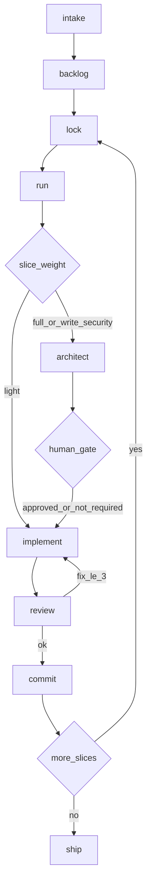

# Agent Constitution — The Assembly Line

This is the **single source of truth** for the agent process. Every command, skill, and agent points here. Change the process by editing this folder — nowhere else.

---

## The pipeline

```text
discover/intake -> discover/backlog
    -> deliver/lock -> deliver/run (design? -> implement -> review, fix <= 3)
    -> ops/commit   (x N slices)
    -> ops/ship
```



---

## Stages

### discover

| Step | Input | Output | Notes |
|------|-------|--------|-------|
| `intake` | Raw business input (requests, notes, CSV) dropped in `.agent/_imports/` | Structured summary | Plan-only. Never writes code. |
| `backlog` | Intake summary | Ordered slices in `.agent/slices/` | Each slice gets a **weight** (see `classes.md`). |

### deliver

| Step | Input | Output | Notes |
|------|-------|--------|-------|
| `lock` | Chosen slice number | `workflow_state.md` active slice set | **WIP=1**. Refuse if a slice is already locked and not `done`. |
| `run` | Locked slice | Working code + review verdict | Orchestrates the stage loop below. Owns remediation cap. |

`run` internal loop:

1. Read slice weight.
2. `light` -> go straight to **implement**.
3. `full` / `write-security` -> **architect** produces a design doc in `.agent/designs/` first.
4. `write-security` -> **STOP for human approval** of the design before implement.
5. **implement** -> **review**.
6. If review returns issues: **implement** fix. Repeat review. **At most 3 fix cycles.**
7. After 3 unresolved cycles -> stop, summarize, ask the human.
8. On approval (no open P0/P1) -> prepare commit.

### ops

| Step | Input | Output | Notes |
|------|-------|--------|-------|
| `commit` | Approved slice | One commit | Auto-commit OFF by default; prepare + wait unless told to commit. |
| `ship` | Branch with N commits | Pushed branch + PR | Runs CI gate first. Only after CI passes. |

---

## Hard rules

- **WIP = 1.** One locked slice at a time.
- **Remediation cap = 3**, then human.
- **Weight gate** decides whether a design doc and human approval are required.
- **Auto-commit OFF**; never push unless the human says "push" or "open a PR".
- **Scope is binding.** Out-of-scope discoveries go to `.agent/follow-ups/`, not the current slice.

---

## Session protocol

**Start:** read `.agent/project_config.md` then `.agent/workflow_state.md`. If either is missing, stop and ask.

**End:** update `.agent/workflow_state.md` (status, active slice, decisions, blockers, files touched, next 3 actions).

See `schemas/` for the required shape of both files.

---

## Where things live

| What | Path |
|------|------|
| Process (this) | `docs/agent/` |
| Slice weights + gates | `docs/agent/classes.md` |
| Review checklist | `docs/agent/checklist.md` |
| Design principles | `docs/agent/principles.md` |
| State/config schemas | `docs/agent/schemas/` |
| Domain truth (per project) | `docs/core/` |
| Config values (per project) | `.agent/project_config.md` |
| Session memory (volatile) | `.agent/workflow_state.md` |
