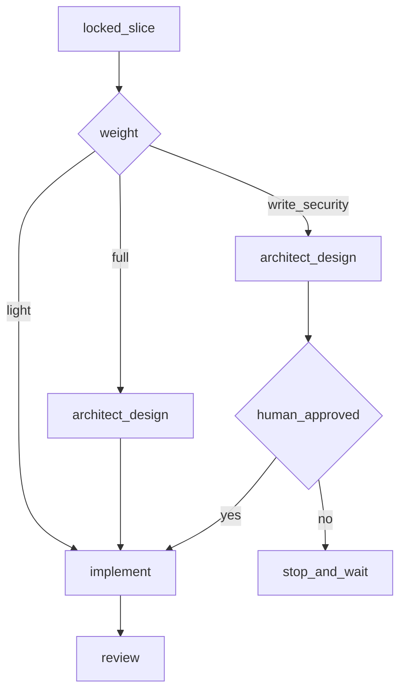

# Slice Weights (Classes)

Every slice gets a **weight** at `backlog` time. Weight decides how much process `run` applies. This keeps small work fast and risky work safe.

---

## Weights

| Weight | When to use | Design doc? | Human gate? | Review |
|--------|-------------|-------------|-------------|--------|
| `light` | Small, low-risk change; no new contract; obvious approach | No | No | Yes (standard) |
| `full` | Non-trivial feature; multiple files; design choices matter | Yes (architect first) | No (recommended for large) | Yes |
| `write-security` | Auth, permissions, tenancy, secrets, migrations, money, PII, public contracts | Yes | **Yes — mandatory before implement** | Yes (security checklist) |

When unsure between two weights, pick the heavier one.

---

## Gate behavior in `run`

## Rules

1. `light` never writes a design doc — going through architect for trivial work is waste (YAGNI).
2. `full` always produces a design doc in `.agent/designs/` before code.
3. `write-security` requires a design doc **and** explicit human approval. The agent must stop and wait — it may not self-approve.
4. Any slice that touches items in the `write-security` trigger list is `write-security`, even if it looks small.

## write-security triggers (non-exhaustive)

- Authentication / authorization / session logic
- Multi-tenant scoping / row ownership
- Secrets, tokens, credentials
- Database migrations / schema changes
- Payments, billing, money movement
- PII handling / export
- Public API contract changes
